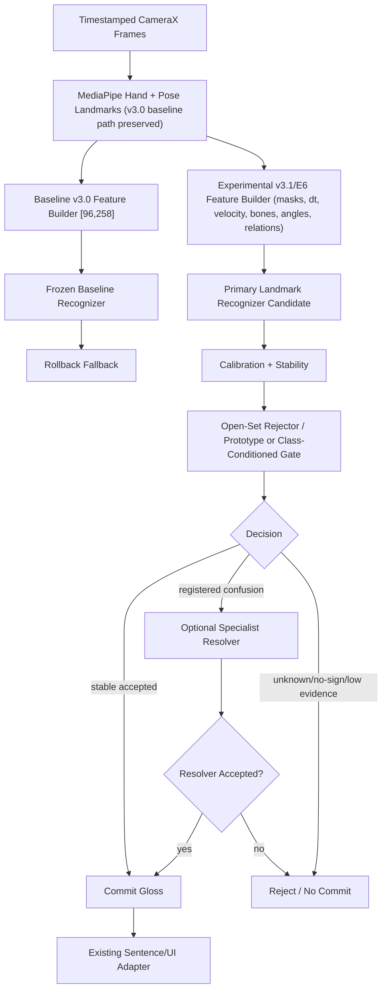

# E6 Production Recognition Architecture Plan

**Purpose:** Replace the E5 threshold/no-go loop with an evidence-driven, modular architecture and experiment path for a safer production recognizer.

**Scope:** Architecture, research planning, experiment design, rollback, and context governance only. This document does not authorize Android implementation, TFLite export, production asset replacement, source dataset mutation, or schema-3.0 modification.

**Current status:** E6 COMPONENT REVIEW COMPLETE / E6-2, E6-3, AND E6-5 NO-GO / E6-4 EVIDENCE-ONLY / E6-6 AND E6-7 BLOCKED / PROTECTED BASELINE PRESERVED.

**Last updated:** 2026-08-09.

## Classification Legend

- **Verified project evidence:** confirmed by AppHear files, context, or completed run metrics.
- **External research evidence:** supported by cited papers, official dataset pages, or benchmark documentation.
- **Engineering inference:** reasoned conclusion from project + external evidence; not yet proven in AppHear.
- **Hypothesis requiring experimentation:** plausible component or method that must pass an AppHear gate before adoption.

## Current-State Audit

### Verified Project Evidence

The protected production path remains:

```text
CameraX -> MediaPipe HandLandmarker + PoseLandmarker -> schema v3.0 [96,258]
  -> [1,96,258] TFLite recognizer -> confirmation -> sentence/UI
```

Current schema v3.0 contains left hand `63`, right hand `63`, and pose `132` values per frame. Face landmarks are not included. Parent contracts require schema checks, train/serve parity, signer-disjoint evaluation, CPU/XNNPACK/INT8 feasibility, and feature-flagged rollback.

The current recognition-upgrade evidence shows:

- E3-C: upper-body RGB and naive fusion were weaker than landmark controls.
- E4-W: a narrow primary-plus-landmark-specialist simulation passed for `GOOD/HELLO/HAVE/KNOW` plus routed `SORRY`, but only as offline evidence.
- E4-Y: zero-landmark no-sign evidence was misleading; real MediaPipe no-sign windows caused severe false commits.
- E4-AG: targeted HELLO-like no-sign expansion recovered the small routed-system safety floor.
- E5-B: 50-class ASL-led landmark diagnostic learned signal but was not exportable: mean latest test `0.4897`.
- E5-D: reduced 15-class validation improved to mean latest test `0.6933`, but weak classes and confusion groups remained.
- E5-G: clean 7-class closed-set retrain improved to mean latest test `0.8472`, but `MEET` and `STAND2` were weak.
- E5-H: confidence-only routed rejection failed; strict thresholds were safe only by rejecting most positives.
- E5-I: a shared accept/reject head improved coverage over E5-H but still failed open-set safety, with full 7-sign mean/min accepted precision `0.8985/0.8333` and positive coverage `0.2778/0.2083`.

### External Research Evidence

- ASL Citizen contains about `83,399` isolated-sign videos, `2,731` signs, and `52` Deaf/HH signers with signer-independent splits. Its own baseline setting is dictionary-like isolated recognition, not open-set silent translation.
- PopSign ASL v1.0 reports `175,022` valid intended-variant examples across `250` signs, about `700` per sign, from `47` Deaf adult signers; its baseline LSTM reports about `84.2%` test accuracy for the full 250-sign isolated problem.
- Open-set skeleton action recognition research explicitly reports that pure skeleton open-set recognition is challenging and evaluates distance/prototype-style methods over joints, bones, and velocities.
- TwoStream-SLR reports a practical research direction: RGB video and keypoint streams can complement one another, but that does not prove AppHear's previous upper-body RGB branch is sufficient.

Sources:

- ASL Citizen dataset description: https://www.microsoft.com/en-us/research/project/asl-citizen/dataset-description/
- ASL Citizen datasheet: https://www.microsoft.com/en-us/research/project/asl-citizen/datasheet/
- PopSign ASL v1.0: https://openreview.net/forum?id=yEf8NSqTPu
- Open-set skeleton action recognition / CrossMax: https://ojs.aaai.org/index.php/AAAI/article/view/28247
- TwoStream-SLR: https://papers.nips.cc/paper_files/paper/2022/hash/6cd3ac24cdb789beeaa9f7145670fcae-Abstract-Conference.html

## Root-Cause Analysis

### Verified Project Evidence

The E5 failure pattern is not just a weak classifier:

- Closed-set landmark recognition can work for selected classes (`E5-G`).
- Open-set routed recognition fails when unsupported signs and real no-sign windows are present (`E5-H`, `E5-I`).
- Small validation sets and confidence thresholds are not enough for silent translation safety.
- Similar signs and source/provenance differences produce class-specific failure, not uniform noise.

### Engineering Inference

The current bottleneck is a combined **data + representation + open-set decision** problem:

1. The E5 datasets are too small for production-scale signer-independent open-set behavior.
2. Schema v3.0 positions alone do not explicitly encode motion, bone geometry, uncertainty masks, or time deltas.
3. Open-set rejection cannot be solved reliably by a global softmax threshold or one shared accept head.
4. RGB should not be applied globally yet because prior AppHear RGB/fusion attempts were weak, but it remains a justified fallback for specific landmark-failed confusion groups.

## Proposed System Diagram



## Component Responsibilities And Gates

| Component | Classification | Problem Solved | Supporting Evidence | Main Risk | Independent Test | Promotion Gate | If It Fails |
|---|---|---|---|---|---|---|---|
| Frozen baseline manifest | Verified project requirement | Protects current app behavior | `ROLLBACK_AND_COMPATIBILITY_PLAN.md`, schema v3.0 contract | Baseline drift | hash current model/vocab/config/schema | reproducible hashes and fallback smoke | stop and repair baseline |
| Dataset audit + learning curve | Engineering inference | Determines whether scale is the true blocker | E5 small rows vs PopSign scale | time cost; source confounds | per-sign/source/signer counts and learning curves | clear data sufficiency estimates | reduce vocabulary or collect/clean data |
| v3.1/E6 richer landmark schema | Hypothesis requiring experimentation | Adds motion/geometry/masks/time missing from [96,258] | E5 confusion + open-set failure; CrossMax uses joints/bones/velocities | parity complexity; overfit | train same classes with v3.0 vs v3.1/E6 | >=5 point open-set accepted-precision/coverage improvement or clear confusion reduction | keep v3.0 primary |
| Explicit unknown/no-sign training | Verified need / hypothesis for implementation | Prevents silent false commits | E4-Y/E5-H/E5-I failures | over-rejects true low-motion signs | isolated gate and joint routed simulation | accepted precision >=0.95 and coverage >=0.80 with no-sign/OOV pressure | add data, reject more, or restrict vocabulary |
| Prototype/distance rejection | Hypothesis requiring experimentation | Tests whether embedding distances reject unsupported signs better than shared accept head | E5-I shared head too blunt; OS-SAR research | overfit to current OOV set | compare softmax, shared head, one-vs-rest, prototype distances | beats E5-I on precision/coverage and per-class recall | abandon or keep diagnostic |
| Confusion registry | Engineering inference | Prevents hard-coded ad hoc specialists | E4-P/E4-Q/E5-D confusion groups | specialist sprawl | offline router replay | stable groups across seeds and splits | keep classes deferred |
| Specialist resolver | Hypothesis requiring experimentation | Handles only recurring hard groups | E4-V/E4-W positive GOOD/SORRY proof; E4-Q failure for broader group | complexity; data shortage | group-only control vs specialist | specialist beats simplest control and passes per-member recall | defer group or repair data |
| Selective RGB branch | Hypothesis requiring experimentation | Recovers handshape/body cues missing in landmarks | TwoStream-SLR external evidence; AppHear RGB no-go as broad branch | mobile cost; crop failure; overfit | group-specific RGB vs landmark vs fusion | RGB/fusion beats landmark control for that group and device cost is feasible | do not ship RGB |
| Android experimental adapter | Future implementation only | Allows default-off testing without replacing baseline | parent rollback contracts | latency/thermal/schema skew | quantized parity + device smoke | runtime gates pass with fallback | feature flag off |

## Data Flow

### Offline Experiment Flow

```text
raw video / existing Stage-E features
  -> signer/source/provenance audit
  -> baseline v3.0 tensor build (control)
  -> experimental v3.1/E6 tensor build (separate artifact)
  -> signer-disjoint train/val/test
  -> primary model control vs richer-feature model
  -> OOV/no-sign pressure set
  -> calibration/rejection experiment
  -> confusion registry candidates
  -> optional specialist experiments
  -> offline routed-system report
```

### Future Android Shadow Flow

```text
current production recognizer remains active
  + experimental recognizer runs default-off or shadow-only
  + no sentence/UI replacement until gates pass
  + fallback loads current v3.0 model if any schema/model/registry check fails
```

## Feature And Model Versioning

### Verified Project Requirement

Schema v3.0 `[96,258]` must remain immutable. Existing production assets must not be overwritten.

### Engineering Inference

The next feature work should use a new experiment-only contract name, for example:

- `apphear.landmark_kinematic.v0`
- output shape is not fixed yet;
- starts from v3.0 positions;
- adds explicit `frame_mask`, hand/pose presence masks, real `dt`, velocity, selected bone vectors, selected joint angles, hand-body/hand-hand relations, duration;
- may later add crop tensors only through a separate specialist schema.

Promotion to a numeric schema such as `4.0` is blocked until offline wins, Kotlin parity, quantization, and device gates pass.

## Experiment Matrix

| ID | Purpose | Inputs | Tests | Go | No-Go / Fallback |
|---|---|---|---|---|---|
| E6-0 | Freeze current baseline | current Android assets + context | hash manifest, git status, asset inventory | hashes recorded and fallback path documented | stop planning until baseline is reproducible |
| E6-1 | Dataset audit and learning curve | ASL Citizen + local + prior E5 tensors | counts by sign/signer/source, leakage checks, 5/10/20/50-class curves | identifies feasible product-core batch and data gaps | collect/clean data before modeling |
| E6-2 | v3.1/E6 landmark feature control | same signs as E5-G/E5-I | v3.0 control vs richer features, same splits/seeds | meaningful open-set/routed gain without worse false commits | keep v3.0 and do not add schema complexity |
| E6-3 | frozen-embedding rejection comparison | frozen v3.0 embedding + OOV/no-sign | MSP and energy controls vs predicted-class shrinkage-Mahalanobis | valid operating point in all seeds; beats confidence frontier without zero-recall classes and materially rejects stress `KNOW -> HELLO` | stop tuning; improve negative diversity or preserve failure for E6-4/E6-5 |
| E6-4 | confusion registry mining | E6-2/E6-3 predictions | stable confusion groups across seeds/sources | registry entries are reproducible | defer unstable signs |
| E6-5 | first specialist proof | registered `KNOW/HELLO` group | frozen primary controls, v3 TCN specialist, geometry TCN specialist; RGB/fusion excluded by duplicate audit | specialist passes fresh/stress/historical, per-member, gain, and seed-stability gates; geometry must justify complexity | defer/recollect `KNOW`; no automatic RGB rerun |
| E6-6 | offline routed-system simulation | primary + rejector + registry + specialists | accepted precision, coverage, no-sign/OOV, per-class recall | release-style offline gates pass | simplify system or reduce vocabulary |
| E6-7 | Android shadow feasibility | quantized assets, default-off flag | parity, latency, p95, FPS, thermal, fallback | device gates pass | feature flag off; production v3.0 remains active |

## Acceptance Gates

The E6 architecture does not lower the release bar. A component cannot move forward unless it passes its own gate and improves the routed system. Required minimums inherit from `EVALUATION_AND_ACCEPTANCE_GATES.md`:

- top-1 >= `0.85`, macro-F1 >= `0.85`, worst-decile F1 >= `0.75` for isolated release candidates;
- accepted precision >= `0.95` at coverage >= `0.80`;
- no-sign/OOV false commits <= `1` per `30` minutes for release;
- p95 commit latency <= `750 ms`;
- Android p95 inference/capture budget must preserve real-time behavior;
- train/serve parity required before runtime integration.

## Failure And Rollback Paths

- If E6-1 shows insufficient data, stop modeling and produce a data collection/cleanup plan.
- If E6-2 richer features do not beat v3.0, keep v3.0 and do not add schema complexity.
- If E6-3 rejection fails, do not tune thresholds endlessly; either reduce vocabulary or increase negative/OOV diversity.
- If both E6-5 landmark specialists fail, defer/recollect `KNOW`; do not start RGB automatically.
- If E6-6 routed simulation fails, keep all assets offline and preserve current production recognizer.
- If E6-7 Android shadow fails, disable the feature flag and restore the baseline asset package.

## Android Deployment Strategy

Future Android work is blocked until E6-6 passes offline. When approved:

- ship assets under new filenames and manifests;
- keep current v3.0 assets in place;
- load experiment assets asynchronously;
- add a default-off feature flag;
- fail closed on schema, hash, label-order, registry, or specialist mismatch;
- run shadow mode before user-visible commits;
- measure p50/p95 latency, FPS, memory, battery, and thermal decay.

## Exact Files That Would Eventually Be Created Or Modified

No implementation is authorized now. If later approved, likely files include:

- `pipeline/features/landmark_kinematic.py` or equivalent experimental feature builder;
- `pipeline/rgb/e6_*` experiment runners;
- `model/*` open-set/prototype/rejector model definitions;
- `eval/*` routed-system and calibration reports if reusable;
- `context/feature-schema.md` only after `/imprint` and only when a contract passes;
- Android experiment-only recognizer/manifest/feature-flag files under `android/app/src/main/...` and `android/app/src/main/assets/`, never overwriting current assets.

## Protected Files And Assets

Do not overwrite:

- `pipeline/features/contract.py` schema v3.0 behavior;
- Kotlin `S4Features.kt` v3.0 behavior;
- current Android `streaming.tflite`, `model_manifest.json`, `recognition_config.json`, vocab, and backup asset folders;
- current production confirmation behavior;
- existing ASL Citizen/local raw videos and source feature tensors;
- stable Git tag `stable-baseline-before-redesign`.

## Decisions

- Stop treating E5-style threshold, vocabulary shrinking, or shared accept-head runs as the main path.
- Preserve landmark-primary recognition as the current baseline and first control.
- Test richer landmark features and open-set rejection independently before any routed integration.
- Add RGB only after a registered confusion group proves landmarks are insufficient and the RGB branch beats controls.
- Keep the system modular and reversible; no single large rewrite is approved.

## Assumptions

- Existing ASL Citizen and local data rights allow offline derived-feature experiments.
- Raw videos remain available for any future crop/RGB specialist tests.
- Current E5 test sets have been used heavily; promoted claims may need fresh held-out or stricter validation.

## Open Questions

- What is the smallest product-core vocabulary that is valuable enough for a first user-visible milestone?
- How many additional signers/examples are feasible for app-priority signs?
- Which public dataset sources can be legally and practically combined with local AppHear data?
- Can a prototype/distance rejector improve over E5-I without overfitting to current unsupported rows?
- Which hard signs truly need RGB/non-manual cues rather than more consistent labels and data?

## Next Required Action

Prepare E6-0/E6-1 as a planning/data-audit package before more model training. The first useful executable step is a dataset and representation audit that estimates whether the existing ASL Citizen + local inventory can support a product-core batch, and what data is missing before richer-feature or open-set experiments are worth running.

## 2026-08-03 E6-0/E6-1 Validation Result

E6-0 and E6-1 are complete:

- `E6_0_BASELINE_FREEZE.md` records the current baseline model/config/vocab/schema/MediaPipe asset hashes and rollback instructions.
- `E6_1_CONSOLIDATED_EVIDENCE_DATASET_AUDIT.md` consolidates E1-E5 evidence and concludes that current data is insufficient for further modeling.

Decision: E6-2 richer features, E6-3 rejection, E6-4 standalone registry mining, E6-5 specialists/RGB, E6-6 routed simulation, and E6-7 Android shadow mode are blocked. The next action is data readiness, not another model experiment.

## 2026-08-09 E6 Five-Sign Control And E6-2 Architecture Update

The August 3 data-readiness blockade has been satisfied only for the bounded five-sign diagnostic
(`GOOD`, `HELLO`, `SORRY`, `HAVE`, `KNOW`). Clean v3.0 extraction, broad-encoder transfer, and
validation repair produced a frozen control with mean fresh top-1 `0.8889`; fresh `KNOW` recall
remains `0.5611` and variant-stress `KNOW` remains approximately `0.0222`.

`E6_2_RICHER_LANDMARK_CONTROL_PLAN.md` now defines one non-duplicative `[96,444]` geometry
candidate. It excludes the E3-B6/B7 velocity/acceleration package, uses zero-extension warm start,
and preserves all clips, splits, seeds, model-family settings, and evaluation views.

Current next action: review that contract, then implement and smoke-test only E6-2 if approved.
E6-3 rejection, E6-4 registry, E6-5 RGB/specialists, E6-6 routing, E6-7 Android, vocabulary
expansion, export, and production migration remain blocked.

## 2026-08-09 E6-2 Result

E6-2 completed. Geometry improved mean fresh top-1 from `0.8889` to `0.9456` and fresh `KNOW`
recall from `0.5611` to `0.8611`, but failed the preregistered promotion gate: variant-stress
`KNOW` remained `0.0556`, stress overall missed its threshold, and fresh `HAVE` regressed by
`0.0444`. Schema v3.0 remains primary and no further handcrafted geometry subset is approved.

The E6-3 duplicate and architecture review is complete. E4-AA through E4-AG temporal gating,
E4-T/E5-H softmax thresholding, and E5-I shared accept-head training will not be repeated. The
approved next package freezes v3.0 and compares MSP, fixed-temperature energy, and one primary
predicted-class shrinkage-Mahalanobis score over the 64-dimensional TCN embedding. See
`E6_3_OPEN_SET_REJECTION_PLAN.md`. E6-4 and later phases remain blocked until E6-3 completes its
independent gate.

## 2026-08-09 E6-3 Result

E6-3 completed and failed its independent gate. Full negative extraction passed for `1,107`
windows from `804` videos, but MSP, fixed-temperature energy, and predicted-class
OAS-Mahalanobis all lacked a valid development operating point in every seed. At useful coverage,
false accepts were too high; at safety floors, coverage and minimum class recall collapsed.

Decision: retain the frozen v3.0 classifier, add no rejection component to Android, and stop
single-score threshold iteration. The next action is architecture-only E6-4 confusion registry
mining over frozen predictions. See `E6_3_OPEN_SET_REJECTION_RESULT.md`.

## 2026-08-09 E6-4 Result

E6-4 mechanically mined frozen v3.0 and geometry predictions. `KNOW -> HELLO` was the only pair to
meet the fixed two-view, two-signer, all-seed registry rule, with 54 majority-confused samples.
`SORRY -> HAVE` remained a one-view/one-signer diagnostic and was not registered.

Decision: E6-5 may architect exactly one `KNOW/HELLO` specialist proof. No routing, specialist
implementation, RGB training, export, or Android work is authorized before that duplicate and data
review. See `E6_4_CONFUSION_REGISTRY_RESULT.md`.

## 2026-08-09 E6-5 Package

The duplicate review excluded RGB and fusion: E3-B3/E3-C already showed that the available
upper-body RGB stream overfits and damages landmarks, and E4-V's RGB specialist was unstable.
E6-5 therefore compares only a seed-matched v3.0 TCN specialist and an E6-2 geometry TCN
specialist against frozen five-way and pair-restricted controls.

The prepared pair inventories are `253/65/90/120/27` rows for
train/validation/stress/fresh/historical. v3 and geometry rows, lineage, masks, and base channels
align exactly. Both real-data branch smokes passed, including 17-layer warm start, forward pass,
one training step, save, and reload. Full training is the next user-run action. E6-6, RGB, export,
and Android remain blocked. See `E6_5_KNOW_HELLO_SPECIALIST_PLAN.md` and
`E6_5_KNOW_HELLO_SPECIALIST_PACKAGE.md`.

## 2026-08-09 E6-5 Result And Component Gate

Full E6-5 training completed. The v3 specialist improved fresh pair accuracy by only `0.0167`
and stress by `0.0111`; geometry improved fresh by `0.0639` and stress by `0.0148`. Stress
`KNOW` recall remained `0.0556` for v3 and `0.0667` for geometry versus the `0.70` gate. No
branch passed or was selected.

E6-6 is blocked rather than weakened: E6-3 supplied no passed rejector and E6-5 supplied no
passed specialist. E6-7 remains blocked because E6-6 cannot run as designed. `KNOW` is deferred,
and no E6 artifact replaces the current Android recognizer. See
`E6_5_KNOW_HELLO_SPECIALIST_RESULT.md` and `E6_COMPONENT_DECISION.md`.
