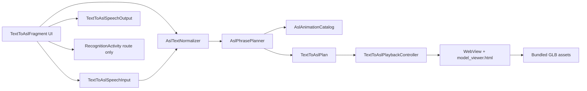

# Text-to-ASL Architecture Plan

Last updated: 2026-07-22

Status: Phases T1-T6 and expanded GLB rollout complete; recent history remains deferred

## Purpose

Define the safe implementation plan for completing the native AppHear3 Text-to-ASL feature using
AppHear2 as the UI/playback reference while keeping AppHear3 recognition and runtime logic isolated.

This document exists because the current `TextToAslFragment` is a build-green visual shell only.
The WebView avatar, GLB playback, phrase planning, speech input, speech output, and recent-history
behavior were intentionally deferred until this contract was documented.

## Scope

In scope:

- Text input to ASL animation playback.
- Speech input to text, then the same ASL animation playback path.
- Replay and clear controls.
- WebView-hosted GLB avatar playback matching AppHear2 behavior where safe.
- Local phrase/letter animation planning based on a bundled manifest.
- Optional local Android text-to-speech output for the entered phrase.
- A small local recent-input store only after retention behavior is explicit.

Out of scope for this feature:

- AppHear3 recognition, prediction confirmation, CameraX, MediaPipe, model inference, temporal
  buffering, runtime profiling, and model assets.
- AppHear2 old recognition classes, old classifiers, old MediaPipe wrappers, face landmarking,
  GenAI gloss translation, Supabase auth/profile, and cloud speech as a default behavior.
- React Native or any framework conversion.

## Source-of-truth files

AppHear3 target files:

- `android/app/src/main/java/com/example/apphear/ui/texttoasl/TextToAslFragment.kt`
- `android/app/src/main/res/layout/fragment_text_to_asl.xml`
- `android/app/src/main/res/navigation/app_shell_nav.xml`
- `android/app/src/main/java/com/example/apphear/RecognitionActivity.kt`
- `android/app/build.gradle.kts`
- `android/gradle/libs.versions.toml`
- `android/app/src/main/assets/`

AppHear2 reference files:

- `D:/Programming/MOBILE APP/3.1 New Way/backup/AppHear2/app/src/main/java/com/example/apphear/texttoasl/TextToAslActivity.java`
- `D:/Programming/MOBILE APP/3.1 New Way/backup/AppHear2/app/src/main/java/com/example/apphear/avatar/AvatarPlaybackController.java`
- `D:/Programming/MOBILE APP/3.1 New Way/backup/AppHear2/app/src/main/java/com/example/apphear/texttoasl/AslAnimationAsset.java`
- `D:/Programming/MOBILE APP/3.1 New Way/backup/AppHear2/app/src/main/java/com/example/apphear/texttoasl/AslAnimationRegistry.java`
- `D:/Programming/MOBILE APP/3.1 New Way/backup/AppHear2/app/src/main/java/com/example/apphear/texttoasl/AslPhrasePlanner.java`
- `D:/Programming/MOBILE APP/3.1 New Way/backup/AppHear2/app/src/main/java/com/example/apphear/texttoasl/AslTextNormalizer.java`
- `D:/Programming/MOBILE APP/3.1 New Way/backup/AppHear2/app/src/main/java/com/example/apphear/texttoasl/SpeechInputManager.java`
- `D:/Programming/MOBILE APP/3.1 New Way/backup/AppHear2/app/src/main/java/com/example/apphear/data/RecentSignsStore.java`
- `D:/Programming/MOBILE APP/3.1 New Way/backup/AppHear2/app/src/main/java/com/example/apphear/utils/TtsVoiceHelper.java`
- `D:/Programming/MOBILE APP/3.1 New Way/backup/AppHear2/app/src/main/java/com/example/apphear/utils/ElevenLabsSpeechPlayer.java`
- `D:/Programming/MOBILE APP/3.1 New Way/backup/AppHear2/app/src/main/assets/model_viewer.html`
- `D:/Programming/MOBILE APP/3.1 New Way/backup/AppHear2/app/src/main/assets/asl_animations/manifest.json`
- `D:/Programming/MOBILE APP/3.1 New Way/backup/AppHear2/app/src/main/assets/asl_animations/*.glb`
- `D:/Programming/MOBILE APP/3.1 New Way/backup/AppHear2/app/src/main/res/layout/activity_text_to_asl.xml`

## Verified facts

- Current AppHear3 `TextToAslFragment` only previews entered text and shows deferred speech/playback
  messages. It starts `RecognitionActivity` for the response/recognition action.
- AppHear2 implements Text-to-ASL as a Java `TextToAslActivity` with:
  - `WebView` avatar stage.
  - `AvatarPlaybackController` using `androidx.webkit.WebViewAssetLoader`.
  - `model_viewer.html` with two `<model-viewer>` elements and JavaScript functions
    `playSign(url)` and `preloadSign(url)`.
  - `AslAnimationRegistry` reading `assets/asl_animations/manifest.json`.
  - `AslPhrasePlanner` using longest-alias matching, then letter fallback.
  - `SpeechInputManager` using `RecognizerIntent.ACTION_RECOGNIZE_SPEECH`.
  - Android `TextToSpeech`, with `ElevenLabsSpeechPlayer` as an optional cloud voice wrapper.
  - `RecentSignsStore` using `SharedPreferences` and retaining up to six first words.
- AppHear2 bundles 66 `.glb` files totaling about 159.22 MB under `assets/asl_animations/`.
- AppHear2 also bundles old TFLite/MediaPipe/face/model assets. Those are not part of this feature.
- AppHear2 `model_viewer.html` currently loads `@google/model-viewer` from
  `https://unpkg.com/@google/model-viewer/dist/model-viewer.min.js`, so the old viewer is not fully
  offline unless that script is vendored or replaced.
- Current AppHear3 does not include `androidx.webkit`. It already includes AppCompat, Material,
  ConstraintLayout, Activity, Navigation, ViewPager2, CameraX, MediaPipe Tasks Vision, coroutines,
  lifecycle runtime, and TensorFlow Lite.

## Dependencies

Required for first functional playback:

- `androidx.webkit:webkit` only if using `WebViewAssetLoader`.
- Platform `WebView`.
- Bundled `model_viewer.html`.
- Bundled `asl_animations/manifest.json`.
- A selected GLB asset set copied from AppHear2 after size/provenance review.

Not required for first functional playback:

- CameraX, MediaPipe, TensorFlow Lite, AppHear3 recognition pipeline changes.
- Supabase or auth dependencies.
- ElevenLabs or any third-party network client.
- Room/DataStore.
- Tasks GenAI.

## Proposed AppHear3 package structure

```text
com.example.apphear/
  domain/texttoasl/
    AslAnimationAsset.kt
    AslAnimationCatalog.kt
    AslPhrasePlanner.kt
    AslTextNormalizer.kt
    TextToAslPlan.kt
  ui/texttoasl/
    TextToAslFragment.kt
    TextToAslPlaybackController.kt
    TextToAslSpeechInput.kt
    TextToAslSpeechOutput.kt
  data/texttoasl/
    RecentTextToAslStore.kt        # deferred until retention decision
```

The domain planner must stay pure and unit-tested. The UI controller owns WebView lifecycle. The
data store must not be added until the user-facing retention behavior is accepted.

## Target architecture



Recognition remains outside this graph. `TextToAslFragment` may open `RecognitionActivity`, but it
must not import or call `FrameAnalyzer`, `RecognitionPipeline`, TFLite recognizers, MediaPipe
landmarkers, confirmation classes, or temporal buffering classes.

## Implementation phases

### Phase T0 - Inventory and safety checks

- Record exact AppHear2 GLB count, total size, and manifest coverage.
- Verify every manifest asset path exists.
- Check whether `model_viewer.html` can run offline. If not, decide whether to vendor
  `model-viewer.min.js` or keep network loading deferred.
- Confirm asset ownership/license and APK-size budget before full GLB import.
- No AppHear3 app code changes except this documentation.

Exit gate: written inventory and decision on initial asset slice versus full import.

### Phase T1 - Pure Kotlin planning layer

Status: COMPLETE on 2026-07-22. Added domain/texttoasl Kotlin classes and TextToAslPlannerTest; 	estDebugUnitTest assembleDebug passed.

- Rebuild AppHear2 `AslAnimationAsset`, `AslAnimationRegistry`, `AslTextNormalizer`, and
  `AslPhrasePlanner` in Kotlin under `domain/texttoasl/`.
- Keep the algorithm equivalent to AppHear2 initially:
  - normalize lowercase US English;
  - strip unsupported punctuation;
  - map `hi`/`hey` to `hello`;
  - longest alias match first;
  - fallback to per-letter clips where present;
  - report unsupported tokens.
- Add unit tests for normalization, longest phrase matching, letter fallback, unsupported tokens,
  and manifest validation.

Exit gate: `testDebugUnitTest assembleDebug` passes without WebView/GLB playback enabled.

### Phase T2 - Asset gate and first playback slice

Status: COMPLETE for starter smoke slice on 2026-07-22. Imported `model_viewer.html`, local `@google/model-viewer` 4.3.1 script/license, filtered `asl_animations/manifest.json`, and six GLBs: `asl_idle.glb`, `hello.glb`, `thank-you.glb`, `GOOD.glb`, `anim_a.glb`, `anim_b.glb`. Full 66-GLB import remains gated.

- Copy `model_viewer.html` only after deciding how to handle the network `model-viewer` script.
- Copy `asl_animations/manifest.json` and a small smoke-test GLB slice first, not all 159 MB:
  - `asl_idle.glb`
  - `hello.glb`
  - `thank-you.glb`
  - `anim_a.glb`
  - `anim_b.glb`
  - one representative uppercase dataset clip such as `GOOD.glb`
- Adjust or filter the catalog so the app does not expose aliases for missing GLBs during the slice.
- Add an asset-validation unit test that fails on manifest paths missing from bundled assets.

Exit gate: app builds and planner only returns bundled assets.

### Phase T3 - WebView avatar controller

Status: COMPLETE for starter smoke slice on 2026-07-22. Added AndroidX WebKit 1.16.0 and Kotlin `TextToAslPlaybackController` using `WebViewAssetLoader`.

- Add AndroidX WebKit in the version catalog and Gradle only for `WebViewAssetLoader`.
- Add a `WebView` to `fragment_text_to_asl.xml` in the existing avatar stage, preserving the current
  AppHear2-style layout.
- Implement `TextToAslPlaybackController` in Kotlin:
  - JavaScript enabled only for bundled local viewer content.
  - Intercept local assets through `WebViewAssetLoader`.
  - Disable unnecessary file/content access where compatible.
  - Queue playback until viewer readiness.
  - Release WebView on `onDestroyView`.
  - Do not enable WebView debugging in release builds.

Exit gate: build passes and device smoke confirms idle GLB loads without touching recognition.

### Phase T4 - Connect text input to playback

Status: COMPLETE for starter smoke slice on 2026-07-22. `TextToAslFragment` now loads the local catalog, plays planner output, supports replay/clear, and reports unsupported tokens.

- Replace preview-only behavior in `TextToAslFragment` with planner output.
- `SIGN IT` creates a plan and starts the playback queue.
- `Replay` restarts the current plan.
- `Clear` stops scheduled playback and returns the avatar to idle.
- Display current sign and progress as `index / total`.
- Show explicit unmapped-token messages when a word/letter cannot be played.

Exit gate: text entry, replay, clear, and unknown-input behavior are device-smoked.

### Phase T5 - Speech-to-text

- Implement `TextToAslSpeechInput` using Activity Result + `RecognizerIntent`.
- No recognition pipeline dependency is introduced.
- Text mode remains available when no speech recognizer exists.
- On recognized speech, fill the text field and route through the same planner/playback path.
- Add `RECORD_AUDIO` permission only if device testing proves the recognizer path requires it; do not
  copy the AppHear2 manifest permission blindly.

Exit gate: speech available/unavailable states are verified on device.

### Phase T6 - Local speech output

- Add Android `TextToSpeech` for speaking the entered phrase only.
- Use AppHear2 `TtsVoiceHelper` behavior as reference, rebuilt in Kotlin.
- Do not add ElevenLabs/cloud voice in the default implementation.
- If cloud voice is later approved, add it as an optional provider with no hardcoded secrets and clear
  privacy/network UI.

Exit gate: TTS initializes, speaks, stops, and shuts down cleanly.

### Phase T7 - Recent activity/history

- Add a local recent Text-to-ASL store only after deciding:
  - retention size;
  - whether phrases or first words are stored;
  - whether clear-history is required;
  - whether recent activity appears on Home.
- AppHear2 `RecentSignsStore` is reference only. Rebuild in Kotlin with explicit naming and tests.

Exit gate: local store tests pass and UI labels truthfully describe retained data.

### Phase T8 - Full asset rollout and stabilization

- Import the remaining approved GLB assets.
- Regenerate or validate the final manifest.
- Measure debug/release APK size delta.
- Device-smoke long playback, fragment navigation away/back, orientation/lifecycle if supported, and
  low-memory WebView behavior.

Exit gate: full Text-to-ASL function works and `testDebugUnitTest assembleDebug` passes.

## Decisions

- Text-to-ASL is independent from AppHear3 recognition. It must not reuse AppHear2 recognition or
  confirmation code.
- WebView/GLB playback can be adapted from AppHear2, but only behind a local asset catalog and
  lifecycle controller.
- The first implementation should use a small GLB slice, not import all 159 MB at once.
- Android TTS is the default speech-output path. ElevenLabs/cloud voice is deferred.
- Speech input uses Android recognizer availability checks and degrades to text input.
- The current `RecognitionActivity` route remains a route only. Text-to-ASL does not own camera.

## Assumptions

- The AppHear2 GLB assets are allowed to be reused in AppHear3.
- A larger APK is acceptable only after measurement and explicit approval.
- The user wants AppHear2 behavior fidelity, but with safer Kotlin/XML architecture and AppHear3
  runtime boundaries.
- Offline-first playback is preferred; if `model-viewer` cannot be vendored, network dependency must
  be surfaced before release.

## Known risks

- APK size increases by about 159 MB if all current AppHear2 GLBs are bundled.
- AppHear2 `model_viewer.html` depends on a remote script from `unpkg.com`; offline playback may fail
  unless fixed.
- WebView lifecycle leaks can retain memory after navigating away from `TextToAslFragment`.
- JavaScript bridge exposure must remain limited to local trusted viewer content.
- Manifest aliases can point to missing assets if only a partial GLB slice is copied.
- Speech recognizer behavior depends on installed Google/system speech services and may require
  network on some devices.
- Cloud ElevenLabs voice would require secrets, network, privacy messaging, and failure handling; it
  should not be copied as part of the first functional pass.
- AppHear2 contains mojibake in some user-facing strings/comments. Text copied into AppHear3 must be
  rewritten as clean UTF-8/ASCII where possible.

## Testing checklist

- `.\gradlew.bat testDebugUnitTest assembleDebug --console=plain --no-daemon --max-workers=2`
- Unit tests:
  - normalizer;
  - manifest parsing;
  - missing asset detection;
  - longest phrase match;
  - letter fallback;
  - unsupported token reporting.
- Manual/device:
  - launch app shell;
  - open Text-to-ASL;
  - verify idle avatar load;
  - type `hello`, `thank you`, `hi`, `abc`, and an unsupported word;
  - verify `SIGN IT`, progress, replay, clear;
  - navigate away/back without crash;
  - open RecognitionActivity and confirm camera/runtime still starts;
  - speech input available/unavailable state;
  - TTS speak/stop after Phase T6.

## Rollback strategy

- Each phase must be build-green before continuing.
- If a phase fails:
  1. stop adding features;
  2. identify the first compiler/resource/runtime error;
  3. revert only the files changed in that phase or disable the feature path behind the existing
     placeholder UI;
  4. rebuild;
  5. document the cause and resolution in `context/progress-tracker.md`.
- Never revert or edit recognition/model assets to fix Text-to-ASL build issues.

## Files safe to modify first

Documentation and planning:

- `context/text-to-asl-architecture-plan.md`
- `context/android-app-redesign.md`
- `context/android-ui-architecture.md`
- `context/android-screen-mapping.md`
- `context/android-migration-plan.md`
- `context/progress-tracker.md`

Phase T1 implementation:

- new files under `android/app/src/main/java/com/example/apphear/domain/texttoasl/`
- new unit tests under `android/app/src/test/java/com/example/apphear/domain/texttoasl/`

Phase T2/T3 implementation after gates:

- selected files under `android/app/src/main/assets/asl_animations/`
- `android/app/src/main/assets/model_viewer.html`
- `android/gradle/libs.versions.toml`
- `android/app/build.gradle.kts`
- `android/app/src/main/res/layout/fragment_text_to_asl.xml`
- `android/app/src/main/java/com/example/apphear/ui/texttoasl/TextToAslFragment.kt`
- new files under `android/app/src/main/java/com/example/apphear/ui/texttoasl/`

## Files that must remain untouched initially

- `android/app/src/main/java/com/example/apphear/RecognitionActivity.kt`
- `android/app/src/main/java/com/example/apphear/pipeline/**`
- `android/app/src/main/java/com/example/apphear/FrameAnalyzer.kt`
- `android/app/src/main/java/com/example/apphear/LandmarkerBundle.kt`
- `android/app/src/main/java/com/example/apphear/OverlayView.kt`
- `android/app/src/main/assets/streaming.tflite`
- `android/app/src/main/assets/model_manifest.json`
- `android/app/src/main/assets/vocab.json`
- `android/app/src/main/assets/recognition_config.json`
- `android/app/src/main/assets/mediapipe/**`
- AppHear2 source tree, except read-only inspection/copying approved UI/avatar assets into AppHear3.

## Related context documents

- `context/android-app-redesign.md`
- `context/android-ui-architecture.md`
- `context/android-screen-mapping.md`
- `context/android-migration-plan.md`
- `context/android-design-system.md`
- `context/device-smoke.md`
- `context/architecture.md`
- `context/feature-schema.md`
## 2026-07-22 UI space cleanup status

- Removed the oversized bottom-panel Respond action from `fragment_text_to_asl.xml`.
- Added compact `reply_button` beneath `btnSpeak`; `TextToAslFragment` routes it to AppHear3 `RecognitionActivity`.
- `MainActivity` hides `app_shell_bottom_nav` only while `R.id.textToAslFragment` is the active destination so the avatar stage can use the full screen height.
- Verification: `./gradlew.bat testDebugUnitTest assembleDebug --console=plain --no-daemon --max-workers=2` passed.
- Recognition, confirmation, camera, temporal, TFLite, MediaPipe, model asset, and schema files were not modified.
## 2026-07-22 Speech input and spoken-output implementation status

- Added shared native Kotlin speech utilities under `android/app/src/main/java/com/example/apphear/ui/speech/`.
- `SpeechInputHelper` uses Android `RecognizerIntent` for speech-to-text; no cloud SDK or AppHear2 Java manager was imported.
- `AppHearSpeechPlayer` attempts ElevenLabs `POST /v1/text-to-speech/{voice_id}` only when `APPHEAR_ELEVENLABS_API_KEY` and `APPHEAR_ELEVENLABS_VOICE_ID` are supplied at build time; otherwise it falls back to Android `TextToSpeech`.
- `TextToAslFragment` uses the existing `btnMic` to capture spoken text into `inputText`, then calls the existing `submitInput()` planner/playback path.
- `TextToAslFragment` uses the existing `btnSpeak` to speak the current/typed text through `AppHearSpeechPlayer`.
- `RecognitionActivity` uses only the existing `speakButton` to speak the current AppHear3 sentence text. Recognition S0-S8 behavior remains unchanged.
- Verification: `./gradlew.bat testDebugUnitTest assembleDebug --console=plain --no-daemon --max-workers=2` passed.
## 2026-07-22 Recognizer reply handoff implementation status

- `RecognitionActivity.speakButton` now starts Android speech-to-text reply capture through `SpeechInputHelper`.
- Valid reply transcripts are sent to `MainActivity` with `EXTRA_OPEN_TEXT_TO_ASL` and `EXTRA_TEXT_TO_ASL_INPUT`.
- `MainActivity` converts the intent extra into the `textToAslFragment` formal `incoming_text` navigation argument and removes the extras after routing.
- `TextToAslFragment` stores `incoming_text` as pending auto-submit state, preserves it with `onSaveInstanceState`, waits for planner/avatar readiness, runs the existing `submitInput()` once, then clears/marks the transcript consumed.
- `RECORD_AUDIO` was not added; this path uses the system recognition activity via `RecognizerIntent`.
- Recognition/camera/model/confirmation/temporal files were not modified.

## 2026-08-02 expanded GLB vocabulary rollout

- Audited `F:/ASL DATASET/NEW BATCH GLB`: 98 GLBs / 173.18 MiB total.
- Excluded `not like-dont like-dislike.glb` because it is a 132-byte empty GLB with no nodes,
  mesh, skin, or animation. The source file was preserved outside the project.
- Reused the existing `thank-you.glb` because the batch copy is byte-identical.
- Added 96 net-new playable GLBs. The bundled Text-to-ASL catalog now contains 102 clips totaling
  185.36 MiB, including the original idle, starter words, and letter fallbacks.
- Renamed the three filenames containing spaces/commas to URL-safe asset names during import.
- Expanded manifest aliases explicitly and made duplicate IDs/aliases fail fast instead of silently
  replacing another animation.
- Playback now advances from the local `model-viewer` animation-completion event. A 7-second safety
  timeout only prevents a malformed clip from stalling; it no longer truncates the 56 audited batch
  animations that exceed the previous fixed 2.5-second timer.
- Apostrophes are removed during Text-to-ASL normalization, so input such as `don't` maps to `dont`.
- Verification: 11 focused Text-to-ASL JVM tests passed; clean `testDebugUnitTest assembleDebug`
  passed; debug APK measured 193.45 MiB.
- Recognition/detection Kotlin, model, vocabulary, config, and MediaPipe assets were hash-verified
  unchanged. This rollout does not alter the recognition vocabulary or S0-S8 runtime.
- Remaining gate: physical-device playback smoke for representative short/long phrases and
  navigation away/back through the WebView lifecycle.
